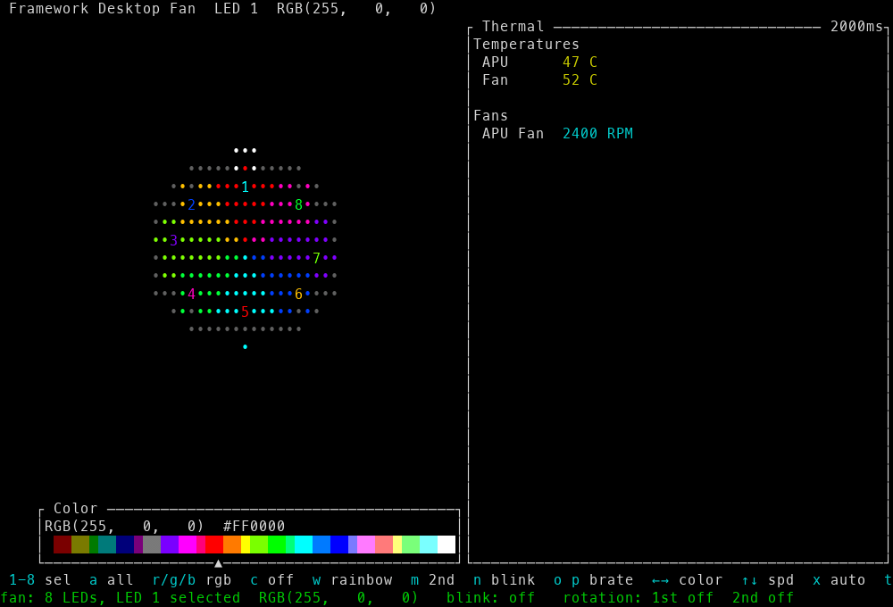

# framework_desktop_tui

A Rust TUI for controlling the RGB fan of the [Framework Desktop], built on
the [framework-system] library.

## Demo

A screenshot of the app (the rainbow it starts with), and a short animation
showing the rotation, the color bar, the two-color blink, and the fan-speed bar:




The animation is generated without hardware: the `capture_demo_if_requested`
test (run with `CAPTURE_DEMO_DIR` set) captures a scripted sequence of frames,
`tools/render_demo.py` renders them to PNGs, and ffmpeg assembles the GIF.

## What it does

The fan is drawn as a filled circle in the middle of the screen: every dot
inside the ring shows the color of the fan LED whose wedge (the 45° sector
around that LED's spot on the ring) it falls in, and each of the 8 LEDs is
marked by a lit point on the ring itself. The LEDs are numbered 1 to 8 — each
number sits in its LED's wedge, drawn in the inverse of the wedge's color
(e.g. a red wedge gets a cyan number) so it stays readable on any color.
Select a LED with the `1` to `8` keys and adjust its color independently —
each LED keeps its own color, written straight to the embedded controller (EC).

Under the ring, a color bar shows a row of 27 fixed color blocks (black on the
left, white on the right); `Left` and `Right` move its pointer one block at a
time (wrapping around at the ends) and set the target LED — or every LED in
all-mode — to that block's color, as a quick alternative to the `r`/`g`/`b`
keys. Its top row shows the pointed color as RGB and hex, and selecting a LED
re-points the pointer at the nearest block.

Toggle `t` and the colors of the layer the color keys are editing travel
around the ring instead: the color of LED 1 moves to position 8, the color of
8 to position 7, and so on (one full turn per second by default), while the
other layer's colors stay put; `s` flips the direction between clockwise and
counter-clockwise, and `+`/`-` set the rotation speed (0.1 to 10 hz) — each
acting on the layer being edited, so the two layers rotate independently. The
rotation is stopped (and `s` and `+`/`-` do nothing) while no color in that
layer is lit.

Each LED can hold a second color. `m` switches the color keys between the
main and the second color, `n` toggles the two-color blink, and while it is
on every LED changes between its two colors at the blink rate (one change per
second by default, `o`/`p` set the rate from 0.1 to 10 hz). A second color
starts off (black), so a blink runs between the main color and off until it
is set.

The fan speed is left to the EC at startup (the EC cannot report it back), so
the vertical speed bar to the left of the circle is not shown until you take
over. `Up` and `Down` take the fan under manual control — the first press
jumps to 75% (`Up`) or 25% (`Down`) — and then nudge it by 5% at a time
(clamped to 0–100%). `x` takes the fan out of the EC's control, starting
manual control at the neutral 50%, and afterwards toggles the EC's automatic
fan control: while it is on, the EC decides the speed, and the stored value
is applied the moment it is switched off.

To the right of the ring, a panel shows the EC's temperature sensors and fan
speeds (the same data `framework_tool --thermal` prints), refreshed every
2000 ms — the interval is shown in the panel's title.

On start the app restores the session it left last time — the main and second
colors of every LED, the rotations, the blink, and the fan speed — so it
never overwrites a lit fan (the EC cannot report the current colors, so the
app keeps them in `~/.local/state/framework_desktop_tui/leds.txt`). On the
first run, with no saved session, it lights the fan with a rainbow.

Press `c` to hand the fan over to a background process: the TUI saves the
whole session, starts a detached copy of the binary that keeps the effects
running, and exits, giving the terminal back to the shell. Running the binary
again takes the fan back (stopping the background process) and restores the
session, so the TUI picks up where you left it.

## Requirements

- A Framework Desktop
- Root privileges (for EC access, just like `framework_tool`)

## Build and run

```sh
cargo build --release
sudo ./target/release/framework_desktop_tui
```

## Controls

| Key          | Action                                             |
| ------------ | -------------------------------------------------- |
| `1`-`8`      | select the LED to adjust                           |
| `a`          | toggle "all LEDs" mode (off by default): when on,  |
|              | the color keys below adjust every LED at once      |
| `r` / `R`    | increase / decrease red                            |
| `g` / `G`    | increase / decrease green                          |
| `b` / `B`    | increase / decrease blue                           |
| `Left`/`Right` | move the color bar's pointer one block left /   |
|              | right (wrapping around) and set the target LED to  |
|              | that block's color                                 |
| `m`          | toggle which color the color keys edit: the LED's  |
|              | main color or its second one (off by default)      |
| `c`          | hand the fan over to a background process: the TUI |
|              | saves the session, starts the background process,  |
|              | and exits; run the binary again to take the fan    |
|              | back and restore the session                       |
| `d`          | toggle the target LED between off (black) and the  |
|              | color it had before                                |
| `w`          | toggle the rainbow preset: every LED takes one hue |
|              | of the color wheel (LED 1 red, stepping around the |
|              | ring); toggling off restores the previous colors   |
| `n`          | toggle the two-color blink: every LED changes      |
|              | between its two colors at the blink rate (one      |
|              | change per second by default)                      |
| `o` / `p`    | decrease / increase the blink rate (color changes  |
|              | per second, 0.1 to 10 hz)                          |
| `t`          | toggle the rotation of the layer the color keys    |
|              | are editing: its colors shift one position around  |
|              | the ring at the rotation speed (one full turn per  |
|              | second by default), the other layer stays put      |
| `s`          | flip the rotation direction of the layer the color |
|              | keys are editing (clockwise / counter-clockwise)   |
| `+` / `-`    | increase / decrease the rotation speed of the layer|
|              | the color keys are editing (full rotations per     |
|              | second, 0.1 to 10 hz)                              |
| `Up`/`Down`  | take the fan under manual control (the first press |
|              | jumps to 75% or 25%) and then nudge the speed by   |
|              | 5%                                                 |
| `x`          | take the fan out of the EC's control, then toggle  |
|              | the EC's automatic fan control                     |
| `q`/`Esc`    | quit                                               |

If the fan cannot be reached (no hardware, not root), the error is shown in
the footer and the TUI stays interactive.

## Tests

The fan logic and the TUI rendering are unit tested — rendering runs against
ratatui's `TestBackend`, so no terminal or hardware is needed:

```sh
cargo test
```

---

This project is developed with the help of an AI coding agent (opencode).

[Framework Desktop]: https://frame.work/desktop
[framework-system]: https://github.com/FrameworkComputer/framework-system
